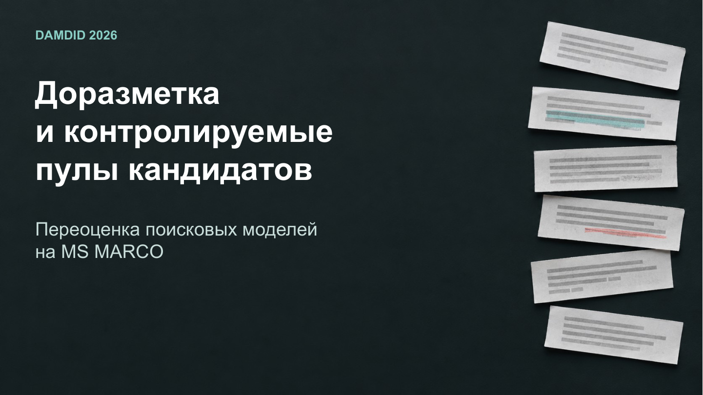

# Hybrid Retrieval Evaluation

An engineering and research communication project on controlled candidate pools,
manual relevance judgments, reciprocal rank fusion, and saved-score evaluation on
MS MARCO. The collection preserves the development sources, calculations,
evaluation results, manuscript revisions, presentation builders, and significant
delivery versions.

## Explore the work

| Material | Entry point |
| --- | --- |
| Checked research manuscript | [Russian PDF](delivery_revision/manuscript_ru.pdf) · [English PDF](delivery_revision/manuscript_en.pdf) |
| Conference presentation | [PDF](DAMDID_2026_Проверено_13-10/DAMDID_2026_Презентация_RU.pdf) · [Editable PowerPoint](DAMDID_2026_Проверено_13-10/DAMDID_2026_Презентация_RU.pptx) |
| Recalculation code | [Manual evaluation](revision_2026/manual_eval.py) · [Full saved-score evaluation](revision_2026/fullset_eval.py) |
| Numerical results | [Manual analysis](revision_2026/results/manual_summary.json) · [Full analysis](revision_2026/results/fullset_summary.json) |
| Editorial manuscript versions | [Version guide](АКТУАЛЬНАЯ_ВЕРСИЯ.md) |

The manual evaluation contains 1,179 queries and 33,667 query–document pairs.
The full saved-score audit covers 101,093 queries and 45,647,587 scores. Results
compare BM25, E5, BGE, reranking, and reciprocal rank fusion under explicitly
defined relevance labels and candidate pools. The preserved outputs include
query-level comparisons, uncertainty estimates, tables, figures, and presentation
chart data.

## What is preserved

- `revision_2026/`: query-level evaluation, uncertainty calculations, tables,
  figures, checked result files, and reproducibility scripts.
- `original_based_2026/` and `editorial_source_revision*`: editorial manuscript
  versions and their source/build scripts.
- `presentation_2026/`: slide builders, chart data, speaker scripts, source
  figures, presentation versions, and development reviews.
- `DAMDID/`, `delivery_*`, and the dated packages: manuscript and presentation
  versions retained with their supporting sources.
- The historical notebook and the research-data release: the original pipeline,
  saved runs/scores, project judgments, annotation categories, and derived arrays.

This GitHub repository preserves the development sources, documents, and retained
result files. The full research-data archive and additional large arrays are
distributed through [the project Telegram channel](https://t.me/zzakazzy).
`RELEASE_ARTIFACTS.json` maps the additional arrays back to their repository paths.
The Telegram archive index supplies the complete part manifest and restoration
instructions; the archive is complete only after every listed part and manifest
has been posted. The large research-data archive is not hosted in GitHub.

## Interpretation of the results

The editorial manuscript and the checked recomputation are distinct versions.
Some editorial versions intentionally retain the earlier reported values. Use
the saved files in `revision_2026/results/` and the corresponding evaluation
code for the checked analysis; do not combine values from different versions.

The recomputation reuses saved retrieval runs, judge scores, labels, and a fixed
threshold. It does not establish a recovered training checkpoint or a fresh
training/inference run. Bootstrap intervals describe uncertainty conditional on
those saved runs, scores, and labels. The original human annotation procedure
and inherited label encoding retain the limitations described in the sources.

## Data and restoration

The original upstream MS MARCO corpus, queries, and official qrels are obtained
from [the official download page](https://microsoft.github.io/msmarco/Datasets).
Their [source terms](https://microsoft.github.io/msmarco/Notice.html) continue to
apply. Raw copied text is replaced by upstream acquisition/hydration instructions
where stated in the research-data manifest. Project-generated numerical results
remain part of the full Telegram archive; their size is not a reason for omission.

`SOURCE_COVERAGE.json` records the staged source decisions. Runtime environments,
Office profiles, operating-system metadata, reproducible compilation auxiliaries,
and separately available third-party reference papers are excluded explicitly.
Personal author/contact fields and client identifiers have been removed from the
public version. External scientific references and third-party license notices
remain with their sources.

Start with [RESTORE.md](RESTORE.md) and [ENVIRONMENT.md](ENVIRONMENT.md). An
archive upload is not evidence that training or all historical builds were rerun.

## Reusable archive workflow

The accompanying [Project Vault skill](tools/project-vault/README.md) supports
closing, anonymizing, finding, and restoring future projects. It is a separate
utility; its public package contains no private client catalog or credentials.
